<p align="center">
  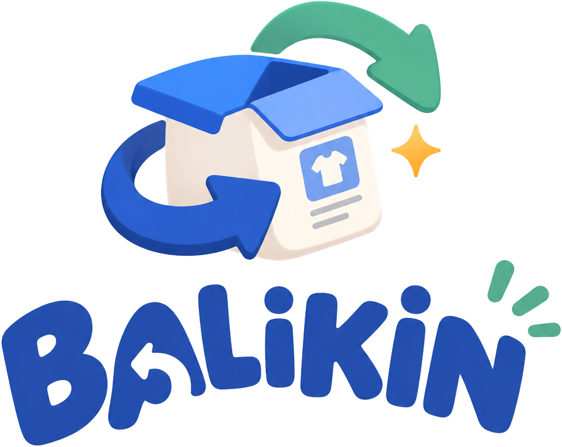
</p>

<h3 align="center">Retur gampang, tinggal Balikin.</h3>

<p align="center">
  Jaringan retur bersama untuk merek lokal: retur dari banyak merek dikumpulkan di satu titik dekat pembeli, lalu dipulangkan dalam satu perjalanan.
</p>

---

## Tentang

BALIKIN adalah prototipe untuk menguji satu pertanyaan: **kapan retur bersama lebih hemat daripada tiap merek mengurus returnya sendiri?** Proyek ini terdiri dari dua bagian dalam satu aplikasi Next.js:

- **Profil perusahaan** di `/`: pengenalan BALIKIN, cara kerja, keunggulan, dan peran pengguna.
- **Aplikasi demo** di `/aplikasi`: ruang kerja dengan tujuh layar untuk menjalankan alur retur dan mengukur biayanya.

Semua data adalah data sintetis dan semua biaya adalah asumsi (mode sandbox), jadi hasilnya bukan bukti kelayakan bisnis.

## Tampilan

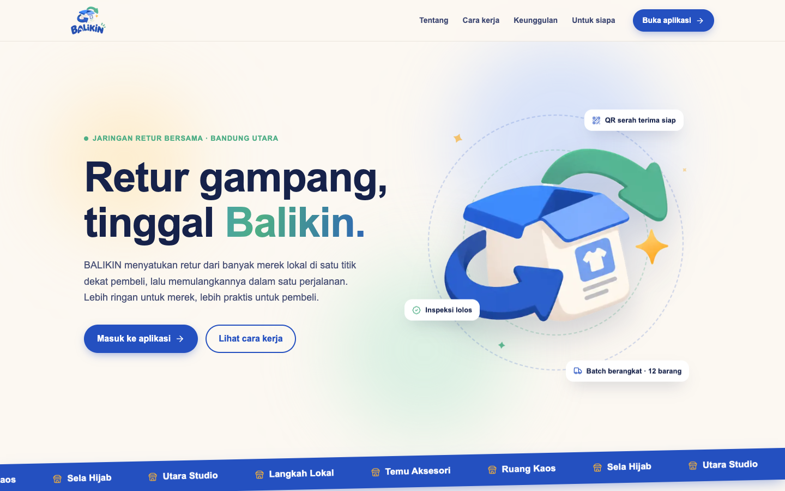

| Dasbor jaringan | Simulator biaya |
| --- | --- |
| 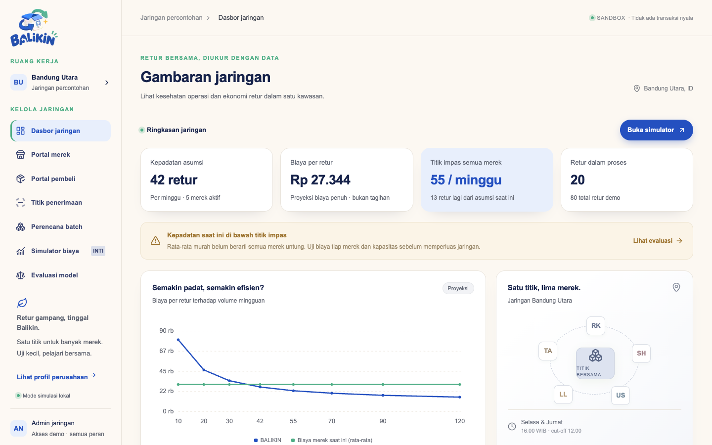 | 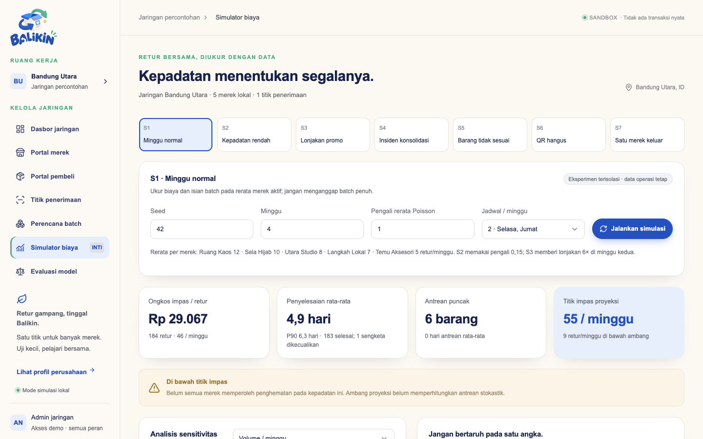 |
| **Portal merek** | **Portal pembeli** |
| 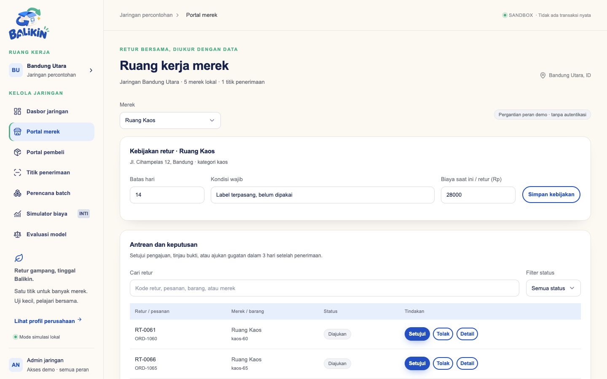 | 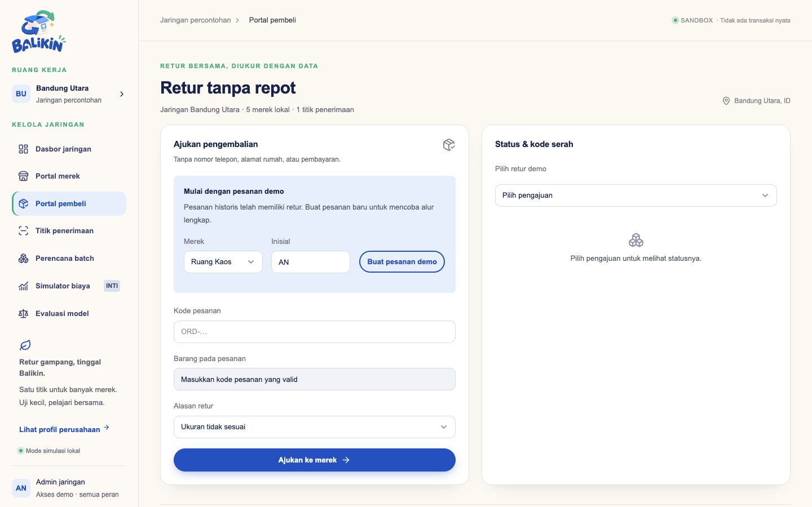 |
| **Titik penerimaan** | **Perencana batch** |
| 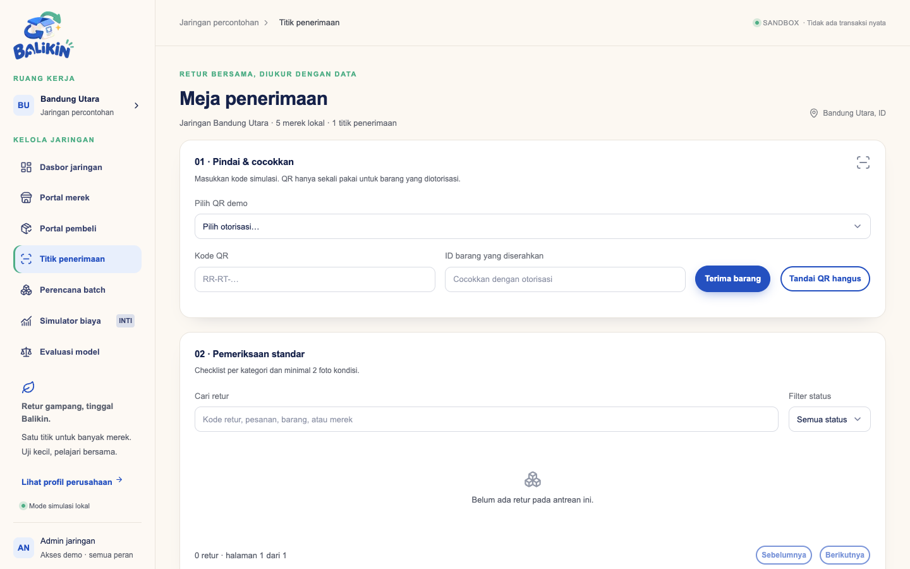 | 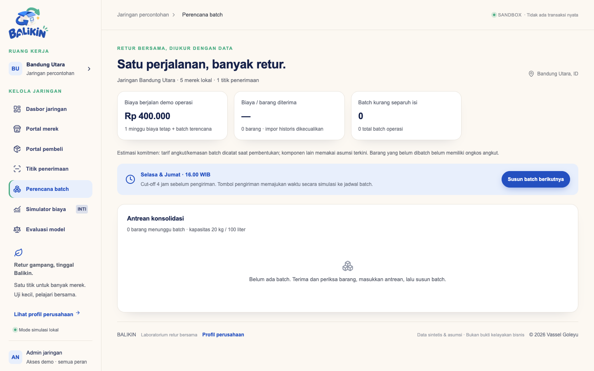 |
| **Evaluasi model** | **Tampilan ponsel** |
| 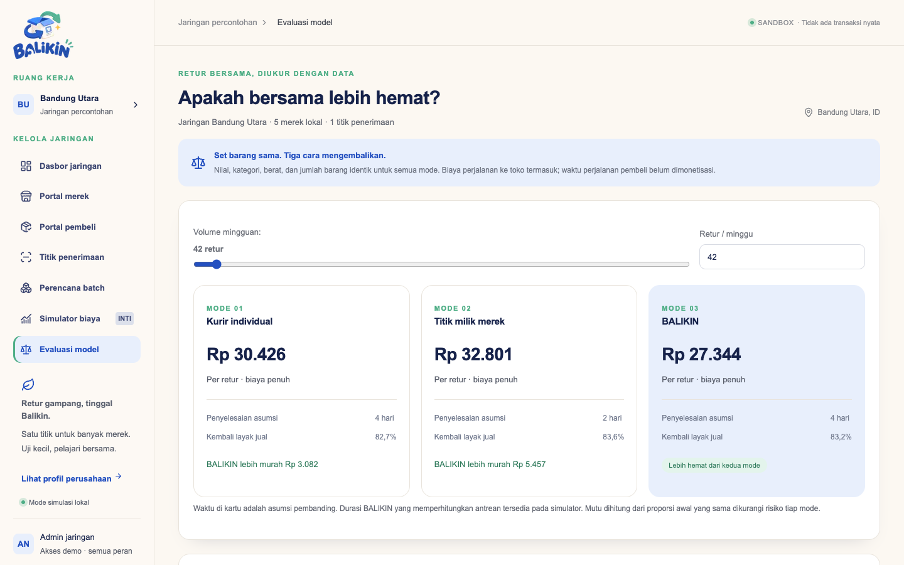 | 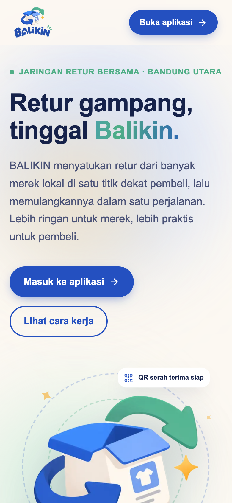 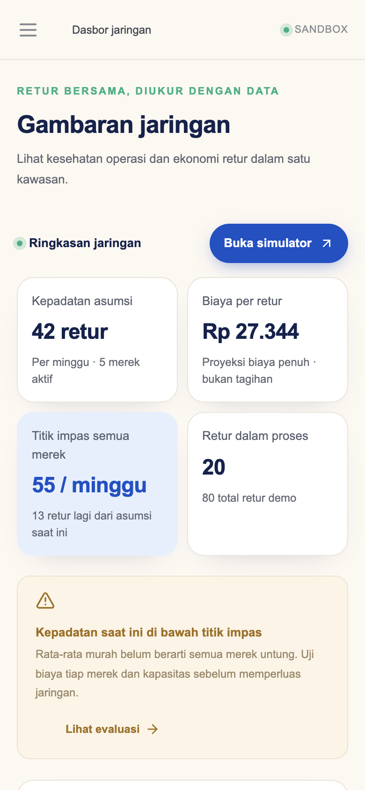 |

## Fitur utama

| Layar | Fungsi |
| --- | --- |
| Dasbor jaringan | Kepadatan, biaya per retur, titik impas, dan kesehatan ekonomi tiap merek. |
| Portal merek | Atur kebijakan retur, setujui pengajuan, putuskan sengketa, pantau biaya per barang. |
| Portal pembeli | Ajukan retur, dapatkan QR serah terima, lacak status. |
| Titik penerimaan | Terima barang lewat QR, foto bukti, pemeriksaan standar, dan sengketa. |
| Perencana batch | Gabungkan retur per merek ke satu perjalanan pulang sesuai jadwal dan kapasitas. |
| Simulator biaya | Skenario S1–S7, analisis sensitivitas, Monte Carlo, dan ekspor CSV. |
| Evaluasi model | Perbandingan biaya kurir individual, titik milik merek, dan BALIKIN. |

## Menjalankan

Butuh Node.js 20 atau lebih baru.

```bash
npm install
npm run dev
```

Buka <http://127.0.0.1:3000> untuk profil dan <http://127.0.0.1:3000/aplikasi> untuk aplikasi.

| Perintah | Fungsi |
| --- | --- |
| `npm run build` lalu `npm start` | Build dan jalankan versi produksi. |
| `npm test` | Tes unit (Vitest). |
| `npm run test:e2e` | Tes browser (Playwright, memakai Google Chrome yang terpasang). |
| `npm run check` | Type-check TypeScript. |
| `npm run format` / `npm run format:check` | Format kode dengan Prettier. |
| `npm run report` | Cetak ringkasan angka model biaya di terminal. |

## Struktur proyek

```text
src/
  app/            Halaman profil (page.tsx), aplikasi (aplikasi/), dan API (api/network/)
  components/     Layar aplikasi, grafik, dan komponen bersama
  domain/         Aturan bisnis: biaya, batch, operasi, simulator, validasi, data awal
  server/         Penyimpanan data JSON dengan kontrol versi
  workers/        Web Worker untuk simulasi Monte Carlo
  config/         Asumsi biaya dan operasi (ganti dengan data nyata)
tests/            Tes unit dan tes browser (e2e/)
scripts/          Skrip laporan model biaya
docs/             Screenshot untuk README
```

## Data

Data aplikasi disimpan di `data/network.json`. File ini dibuat otomatis dari data awal dan tidak di-commit. Lokasinya dapat diganti dengan variabel lingkungan `RETURRUKUN_DATA_DIR`. Di Vercel dipakai `/tmp/balikin` yang bersifat sementara, jadi gunakan database sungguhan bila data harus awet.

## Teknologi

Next.js, React, TypeScript, Tailwind CSS, Zod, dan Lucide.

## Lisensi

© 2026 Vassel Goleyu. All rights reserved. Lihat [LICENSE](LICENSE).
